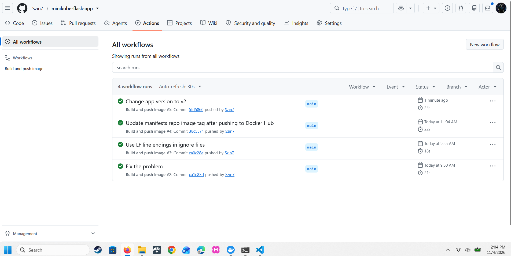
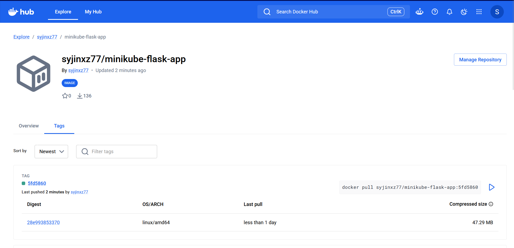
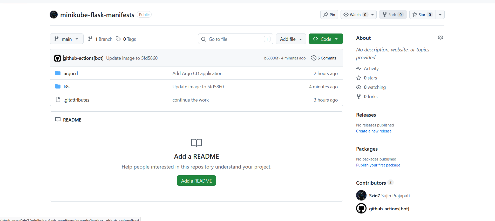
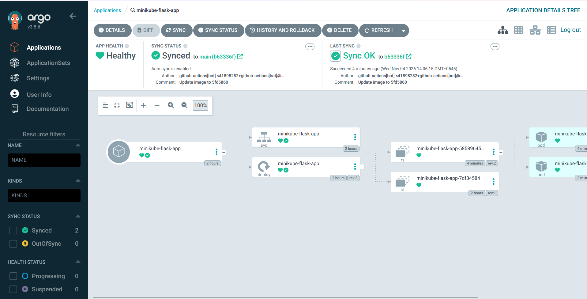
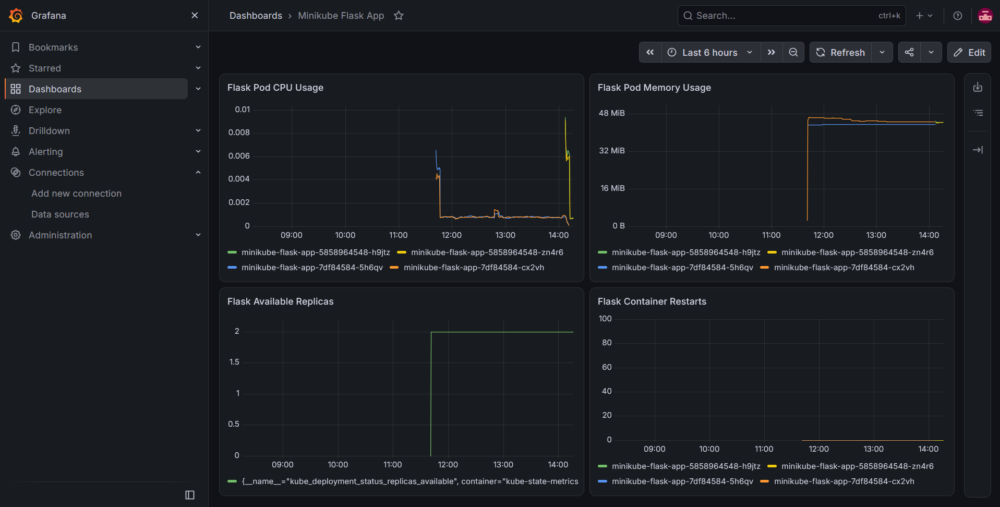

# Minikube Flask App

This project deploys a small Flask application to a local Minikube cluster using GitHub Actions and Argo CD. I kept the application simple so I could focus on building and testing the deployment pipeline from a code change through to the running service.

A push to `main` builds a Docker image, publishes it to Docker Hub and updates the image tag in a separate Kubernetes manifests repository. Argo CD watches that repository and applies the changes to Minikube. Prometheus collects Kubernetes metrics, and Grafana displays them in a dashboard.

## Repositories and image

- **Application and GitHub Actions:** [minikube-flask-app](https://github.com/Szin7/minikube-flask-app)
- **Kubernetes manifests and Argo CD:** [minikube-flask-manifests](https://github.com/Szin7/minikube-flask-manifests)
- **Docker image:** [syjinxz77/minikube-flask-app](https://hub.docker.com/r/syjinxz77/minikube-flask-app)

## Deployment flow

```text
Code pushed to main (application repository)
           |
           v
GitHub Actions: build and push image
           |
           v
Docker Hub: syjinxz77/minikube-flask-app:<commit-sha7>
           |
           v
GitHub Actions updates the manifests repository
           |
           v
Argo CD detects the changed image tag
           |
           v
Minikube: Kubernetes rolls out the new Pods
           |
           v
Running Flask application
           |
           v
Prometheus metrics -> Grafana dashboard
```

GitHub Actions does not need direct access to my local Minikube cluster. Argo CD runs inside the cluster and pulls the desired configuration from Git.

## Tools used

| Tool | Use in this project |
| --- | --- |
| Python, Flask, Gunicorn | Application and HTTP server |
| Docker, Docker Hub | Container image and registry |
| GitHub Actions | Image build, publishing and manifests update |
| Kubernetes, Minikube | Run the containerized application |
| Argo CD | Synchronize the cluster from Git |
| Prometheus, Grafana | Collect and visualize Kubernetes metrics |

## Application

The application is defined in `app.py` and has two routes:

| Route | Response |
| --- | --- |
| `/` | `Hello from minikube-flask-app - version v2` (at the verified v2 release) |
| `/health` | `ok` |

Gunicorn listens on port `5000` inside the container. The Kubernetes Service uses port `80` and forwards requests to the container's port `5000`.

### Run locally

With Python and the matching `venv` package installed:

```bash
python3 -m venv .venv
source .venv/bin/activate
pip install -r requirements.txt
python3 app.py
```

In another terminal, check the endpoints:

```bash
curl http://localhost:5000/
curl http://localhost:5000/health
```

### Run with Docker

```bash
docker build -t minikube-flask-app:local .
docker run --rm -p 5000:5000 minikube-flask-app:local
```

The application is then available at `http://localhost:5000`.

## CI and image updates

The workflow is in [`.github/workflows/build-and-push.yml`](.github/workflows/build-and-push.yml). It runs after a push to `main` and also supports manual runs. Each image is tagged with the first seven characters of its source commit SHA instead of using a fixed `latest` tag.

The workflow needs two secrets in the **application** repository:

- `DOCKERHUB_TOKEN` — publishes the image to Docker Hub.
- `MANIFESTS_REPO_TOKEN` — updates the image tag in the second GitHub repository.

The workflow commits that second-repository change as `github-actions[bot]`. No tokens are stored in the project files.

## Kubernetes and Argo CD

The [manifests repository](https://github.com/Szin7/minikube-flask-manifests) contains the Kubernetes Deployment, Service and Argo CD Application definition.

The Deployment specifies two replicas, container port `5000`, and liveness and readiness checks against `/health`. The Service is `ClusterIP`, so I use port-forwarding to access the app from my laptop. Argo CD deploys the manifests from the `k8s` directory to the `flask-app` namespace with automatic synchronization enabled.

Once Minikube and Argo CD are set up and the application is registered, these commands help check it:

```bash
kubectl get pods -n flask-app
kubectl get deployment -n flask-app
kubectl get svc -n flask-app
kubectl rollout status deployment/minikube-flask-app -n flask-app
kubectl port-forward -n flask-app svc/minikube-flask-app 8080:80
```

With the port-forward running, the application is available at `http://localhost:8080`.

## Monitoring

I reused an existing `kube-prometheus-stack` installation in the `monitoring` namespace. The Grafana dashboard, **Minikube Flask App**, uses metrics collected by Prometheus and contains four panels:

| Panel | Metric |
| --- | --- |
| Flask Pod CPU Usage | Container CPU usage rate per Pod |
| Flask Pod Memory Usage | Container working-set memory per Pod |
| Flask Available Replicas | Available replicas in the Deployment |
| Flask Container Restarts | Recorded restarts for each Flask container |

Prometheus returned two results for `kube_pod_info{namespace="flask-app"}` before the version update. After the rollout, Grafana displayed both historical Pod series and metrics for the new Pods.

To access the tools through separate terminal sessions:

```bash
kubectl port-forward -n monitoring svc/monitoring-kube-prometheus-prometheus 9090:9090
kubectl port-forward -n monitoring svc/monitoring-grafana 3000:80
```

Prometheus opens at `http://localhost:9090`, and Grafana at `http://localhost:3000`. The Grafana dashboard was created in the running monitoring installation; its configuration is not exported in this repository.

## Verified end-to-end run

On **4 November 2026**, I tested the complete deployment by changing `APP_VERSION` from `v1` to `v2`.

| Stage | Evidence |
| --- | --- |
| Application commit | [`5fd5860`](https://github.com/Szin7/minikube-flask-app/commit/5fd5860) |
| GitHub Actions | Build-and-push workflow run #5 completed successfully |
| Docker Hub | Published image `syjinxz77/minikube-flask-app:5fd5860` |
| Manifests update | [`b63336f`](https://github.com/Szin7/minikube-flask-manifests/commit/b63336f), committed by `github-actions[bot]` |
| Argo CD | Synced and Healthy at manifests revision `b63336f` |
| Kubernetes | Deployment rollout completed successfully |
| Running application | `curl http://localhost:8080/` returned HTTP 200 and `version v2` |
| Monitoring | Grafana displayed the new Pod series after the rollout |

These commit IDs document the **verified v2 test**. Later commits, including documentation-only commits, may trigger additional image builds because the workflow runs on every push to `main`.

### Evidence

**GitHub Actions:** successful workflow after changing the app to `v2`.



**Docker Hub:** the image tagged `5fd5860` was published.



**Manifests repository:** the workflow committed the updated image reference.



**Argo CD:** synchronization succeeded and the application was Healthy.



**Grafana:** the dashboard displays CPU, memory, replica and restart metrics for the application.



[Prometheus Pod metrics](screenshots/prometheus-metrics.png) · [Deployment image reference](screenshots/manifest-image-tag.png)


This is a local Minikube deployment project, not a publicly hosted application. The focus is the automated deployment path and the monitoring of the running Kubernetes workload.
